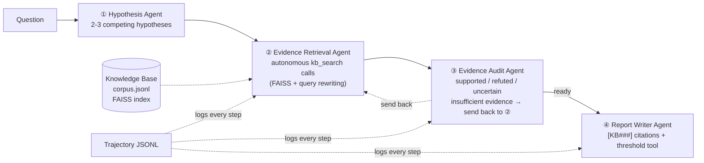
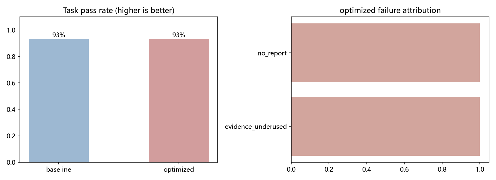

# Red Tide Multi-Agent Reasoning 🌊

An end-to-end **multi-agent system demo** grounded in a real domain scenario — harmful algal bloom (red tide) mechanism reasoning:

**Hypothesis Generation → Evidence Retrieval (RAG) → Evidence Audit (with send-back) → Report Writing**

Built with GLM API + LangGraph + FAISS + MCP + Streamlit, plus a full evaluation and failure-attribution loop.

> 📦 The built-in knowledge base ships with 40 curated **Chinese** entries on red tide (compiled from public domain knowledge; the retrieval model is Chinese-optimized). Swap in your own corpus in any language — see [中文简介](#中文简介). Demo conclusions are illustrative, not scientific advice.

## Architecture



The same knowledge-base tools are also exposed through an **MCP server** (`mcp/`), so Claude Code or any MCP client can call them — write the tools once, use them everywhere. To connect, merge the repo-root `.mcp.json` into your own project (Windows users: change `command` from `python` to `py`).

The Streamlit UI also has a **"Generate report figure"** button: after a run, an LLM drafts an SVG diagram of the report, which is rendered only after passing a **tag/attribute allowlist sanitizer** (scripts, event handlers and external references are rejected) — model output never touches the page raw. Unit tests live in `tests/`.

## When would you use this instead of ChatGPT or Claude Code?

General assistants answer from implicit training memory: no sources, no audit,
no stable process. This project is a vertical-domain **application** built on
top of such models, and it adds four things they do not provide out of the box:

1. **Explicit, swappable, auditable knowledge** — answers must cite `[KB###]`
   entries from a corpus you control (`knowledge/corpus.jsonl`). Swap that file
   and the system answers from your domain instead; your data never leaves
   your machine.
2. **Reliability enforced by architecture, not model goodwill** — the audit
   agent verifies evidence and sends work back when it is insufficient;
   numeric questions are forced through a deterministic threshold-checking
   tool, so the model cannot "do the math" itself.
3. **A fixed, reproducible, evaluated pipeline** — same graph, same 30-task
   set, same scoring rules; anyone can rerun and reproduce the numbers below.
   Interactive chat sessions are inherently ad hoc and hard to measure.
4. **A form factor for non-technical end users** — a web page where someone
   types a question and gets a cited report; no command-line skills required.

And an honest boundary: for one-off general questions, a chat assistant is the
right tool; for coding, use a coding agent like Claude Code (this repo was
developed with one). Reach for a purpose-built agent like this when you need
**private/updatable knowledge + citable answers + a reproducible evaluated
pipeline + a UI for non-technical users** — all four at once.

## Quick Start

```bash
# 1. Dependencies (Python 3.10+, 3.12 recommended)
python -m pip install -r requirements.txt

# 2. Configure: copy .env.example to .env and fill in ZHIPUAI_API_KEY
#    No key? It still runs in offline mock mode (pipeline validation only)
cp .env.example .env

# 3. Five teaching scripts (~10 min each, run in order) + unit tests
python scripts/01_hello_glm.py      # raw LLM API call
python scripts/02_agent_loop.py     # hand-written agent loop, no framework
python scripts/03_build_kb.py       # build FAISS index + retrieval self-test
python scripts/04_test_mcp.py       # speak MCP by hand: initialize → tools/list → tools/call
python -m unittest discover tests -v   # SVG sanitizer unit tests

# 4. One-shot reasoning (report + trajectory saved to disk)
python scripts/05_run_once.py "Why do red tides often follow heavy rain?"

# 5. Demo UI
streamlit run app/streamlit_app.py
```

> Windows: if `python` is not on PATH, use the `py` launcher instead; use `copy` instead of `cp`.

## Evaluation & Failure Attribution

```bash
python eval/run_eval.py --config baseline     # 30 tasks, all optimizations off
python eval/run_eval.py --config optimized    # query rewriting + top_k=5 + audit send-back
python eval/report.py eval/output/baseline/results.jsonl eval/output/optimized/results.jsonl
```

Each task gets a score, a pass flag, a failure category and a trajectory file, plus `eval/output/report.md` and comparison charts. Failures are attributed to six buckets — `tool_error / tool_not_called / no_report / citation_missing / retrieval_miss / evidence_underused` — **attribute first, then optimize**, instead of blindly tweaking prompts.

> In mock mode reports are templated, so pass rates are meaningless. Run both configs with a real GLM key to get your before/after numbers.

## Results (first full run, GLM-5.3-Flash)

| config | pass | rate | notes |
|---|---|---|---|
| baseline | 28/30 | 93% | optimizations off |
| optimized | 28/30 | 93% | query rewriting + top_k=5 + audit send-back |

Failure attribution is where this gets interesting: the harness located **two
runtime crashes** (`no_report` — the model occasionally returned unexpectedly
nested JSON and two agent nodes lacked structure tolerance; fixed in commits
`934384e` and `e80b4a4`, and the affected tasks then pass a live rerun) plus
**one evidence-coverage miss** (a reasoning-synthesis gap, kept as an honest
known limitation). Both numbers above are real first-pass runs — the harness
did its job: attribute first, fix, then verify, instead of blind prompt tuning.
Reproduce with the commands above (~1.5–2.5 h and ~65k–850k tokens per config
on a real key).



Full per-task report: [assets/eval-report.md](assets/eval-report.md).

## Directory

```
redtide/            core package: config / llm / embeddings / kb / tools / agents / graph / trace
scripts/            five teaching scripts (API → agent loop → RAG → MCP → one-shot run)
mcp/                MCP server (stdio) exposing the same knowledge-base tools
app/                Streamlit demo UI
eval/               task set (30) / judge / failure attribution / runner / report
knowledge/          corpus.jsonl + auto-built FAISS index
traces/             one JSONL trajectory per run
LEARNING.md         a five-day path to understanding every line of this repo
tests/              unit tests for the SVG sanitizer
```

## Tech Highlights

| Feature | Implementation |
|---|---|
| Runnable, demonstrable end-to-end demo | Streamlit UI + one-command scripts |
| Agent orchestration (Supervisor + send-back) | LangGraph conditional edges |
| Tool Use / MCP | autonomous function-calling loop + self-built MCP server |
| Memory / RAG | FAISS vector retrieval + embedding cache |
| Evaluation / trajectory analysis / failure attribution | eval/ loop + full trajectories in traces/ |
| Reusable tool components | the three knowledge-base tools mount into any MCP client |

## Design Notes

- **Why a graph instead of one giant prompt**: single-role nodes keep prompts short, controllable and independently testable; conditional edges make the audit send-back a first-class citizen instead of hoping the model complies; explicit state between nodes makes trajectories and failure attribution natural.
- **Tools never raise**: execution errors are fed back to the model as messages, so the agent can retry or change strategy — a crashing tool is the classic agent mistake.
- **Thinking-budget pitfall**: GLM-5.x models reason by default and the reasoning consumes the completion budget (we watched 8,000 tokens of thinking produce zero tokens of answer). The zhipu backend therefore sends `thinking: {"type": "enabled", "effort": "low"}` by default (tune via `LLM_THINKING`), and the SVG figure uses a non-thinking lightweight model through a per-call `model` override.

## Roadmap

- [ ] Plug in a real literature corpus (replace `corpus.jsonl`; the index rebuilds automatically)
- [ ] Persist run history and failure cases in SQLite
- [ ] Sandboxed execution of retrieved analysis code (sub-agent + sandbox)
- [ ] LLM-as-judge to re-check borderline rule-scored samples

## License

MIT — see [LICENSE](LICENSE).

## 中文简介

以"赤潮机制推演"为场景的多智能体教学项目，四步流程：**假设生成 → 证据检索(RAG) → 审计批判(可打回) → 报告撰写**。

三步跑起来：

```bash
python -m pip install -r requirements.txt
cp .env.example .env    # 填入 ZHIPUAI_API_KEY（不填也能用 mock 模式跑通全流程）
streamlit run app/streamlit_app.py
```

- 内置知识库为 40 条**中文**赤潮领域教学条目（检索模型 BGE-zh 为中文优化，故语料与角色提示词保持中文；替换 `knowledge/corpus.jsonl` 即可换成你自己的任意语言语料）。
- `LEARNING.md` 是五天读懂全部代码的路线图；`eval/` 是 30 条任务的评测与失败归因闭环。
- 什么场景该用它而不是直接问 ChatGPT？见上文 "When would you use this instead of ChatGPT or Claude Code?" 一节。
